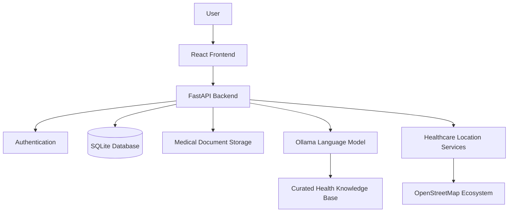

# Sakhi Health

**A Digital Health Companion for Women**

Sakhi Health is a women-focused digital health platform designed to make everyday health information, personal health records, and healthcare discovery more accessible. It brings together an AI-powered health assistant, personal health tracking, reminders, medical document management, and nearby healthcare discovery in a single web application.

The project aims to support women in organizing their health information and exploring general health resources through an accessible digital experience.

**Repository:** [Ishta-P-Jain/Sakhi-Health](https://github.com/Ishta-P-Jain/Sakhi-Health)

> **Disclaimer:** Sakhi Health is intended for general health information and personal health management. It does not diagnose medical conditions or replace professional medical advice.

---

## Table of Contents

- [Problem Statement](#problem-statement)
- [Our Solution](#our-solution)
- [Key Features](#key-features)
- [Technology Stack](#technology-stack)
- [System Architecture](#system-architecture)
- [Getting Started](#getting-started)
- [Environment Configuration](#environment-configuration)
- [API Documentation](#api-documentation)
- [Testing](#testing)
- [Security and Privacy](#security-and-privacy)
- [Current Limitations](#current-limitations)
- [Future Enhancements](#future-enhancements)

## Problem Statement

Managing personal health information can be challenging when records, reminders, health information, and healthcare resources are spread across different platforms.

Some common challenges include:

- **Fragmented health records:** Medical documents and personal health information can be difficult to organize and retrieve.
- **Access to understandable health information:** Finding clear, accessible information about health concerns can require navigating multiple sources.
- **Consistent health management:** Keeping track of personal health entries and reminders requires organization.
- **Healthcare discovery:** Finding relevant healthcare facilities nearby can involve searching across different services.
- **Language accessibility:** Health information is more useful when users can interact with it in a language they understand.

These challenges highlight the need for a convenient platform that brings essential health-management tools together.

## Our Solution

Sakhi Health provides a centralized digital experience for everyday health information and personal health organization.

Through a single application, users can interact with an AI-powered health assistant, maintain health-related records, manage reminders, store medical documents, and explore nearby healthcare facilities.

The platform is designed to support informed health decisions and improve access to health-related resources while keeping professional medical care at the center of healthcare decisions.

## Key Features

### 1. AI-Powered Health Assistant

Sakhi Health integrates a conversational AI assistant that helps users explore general health-related information.

Key capabilities include:

- Conversational interaction for general health questions.
- Support for English, Hindi, Kannada, Tamil, Telugu, and Bengali.
- Integration with a locally hosted language model through Ollama.
- Responses informed by a curated health knowledge base.
- Safety-oriented handling of selected health-related phrases.
- Optional browser-based speech input and text-to-speech output, depending on browser support.

**Purpose:** Make general health information easier to explore through a conversational interface.

**Limitation:** AI-generated responses may be inaccurate or incomplete. The assistant is not a diagnostic tool and should not be used as a substitute for a qualified healthcare professional.

### 2. Personal Health Tracking

The platform provides functionality for recording and managing health-related information.

Users can maintain personal entries and refer to previously recorded information through the application.

This feature is intended to help users keep their health information organized in one place. It does not imply clinical monitoring or automated medical interpretation.

### 3. Health Reminders

Sakhi Health allows users to create and manage health-related reminder records.

This provides a convenient place to organize reminders and refer to them as part of everyday health management.

**Current scope:** Reminders are stored within the application. Automated SMS alerts, push notifications, and background notification delivery are not included in the documented functionality.

### 4. Medical Document Management

Users can manage medical documents through the application.

Supported operations include:

- Uploading medical report files.
- Viewing a list of uploaded reports.
- Downloading stored documents.
- Deleting reports when they are no longer required.

Centralized document management can make it easier to retrieve medical records when preparing for appointments or reviewing personal information.

**Current scope:** The feature stores and manages documents. Automatic OCR, report interpretation, and AI-generated analysis of uploaded medical reports are not included.

### 5. Nearby Healthcare Discovery

The healthcare finder helps users explore healthcare locations using mapping and location services.

The implementation uses Leaflet for interactive maps and services from the OpenStreetMap ecosystem for mapping, geocoding, and healthcare-place discovery.

This feature helps users identify potentially relevant healthcare facilities and explore their locations on a map.

Results depend on the availability and accuracy of external mapping data. Users should independently confirm facility details, services, and availability before visiting.

### 6. User Authentication

Sakhi Health includes account registration and login functionality.

The documented authentication approach includes:

- Password hashing using bcrypt through Passlib.
- JSON Web Tokens (JWT) for authentication.
- Protected API functionality.
- User-associated records to support separation of personal data.

Authentication and authorization are handled through the application's backend. These mechanisms provide a foundation for protecting user information but do not, by themselves, establish production-level security.

### 7. Web-Based User Interface

The application provides a web interface for accessing its health-management features.

React Router supports navigation between views, while Vite provides the frontend development and build tooling.

The interface brings the core capabilities of Sakhi Health together in one application, reducing the need to switch between separate tools for personal records, health information, reminders, and healthcare discovery.

## Technology Stack

| Layer | Technology | Purpose |
|---|---|---|
| Frontend | React 19 | User interface |
| Development and build tooling | Vite 8 | Frontend development and builds |
| Routing | React Router 7 | Client-side navigation |
| Mapping | Leaflet | Interactive maps |
| Backend | FastAPI | API endpoints and backend logic |
| Data validation | Pydantic | Request and data validation |
| ORM | SQLAlchemy | Database operations |
| Database migrations | Alembic | Schema migration management |
| Database | SQLite by default | Application data persistence |
| Authentication | JWT | Authenticated API access |
| Password hashing | Passlib with bcrypt | Password protection |
| AI integration | Ollama | Local language-model inference |
| Map data and location services | OpenStreetMap ecosystem | Mapping and healthcare discovery |

Refer to the repository's dependency and configuration files for the exact versions and current implementation.

## System Architecture

Sakhi Health follows a frontend-backend architecture in which the web application communicates with a backend API that coordinates data storage and external integrations.



### Frontend Layer

The React frontend provides the user interface for authentication, health information, personal records, reminders, document management, chat, and healthcare discovery.

### Backend Layer

FastAPI handles API requests, data validation, application logic, authentication-related operations, and communication with the database, file storage, AI integration, and location services.

### Data Layer

SQLAlchemy provides database access, with SQLite as the default configuration. Alembic supports database schema migrations. Medical documents are stored separately from frontend public assets, while application records manage associated information.

### AI and Location Integrations

The AI assistant connects to an Ollama-hosted language model and uses a curated health knowledge base. Healthcare discovery relies on external location services, which may be affected by connectivity, rate limits, or data availability.

## Getting Started

Follow the steps below to configure the project locally. Use the repository's current configuration files as the source of truth for required settings and startup commands.

### Prerequisites

- Git
- Node.js and npm
- Python and pip
- Ollama, if you want to use the locally hosted AI assistant

Use versions compatible with the project's dependency files.

### 1. Clone the Repository

```bash
git clone https://github.com/Ishta-P-Jain/Sakhi-Health.git
cd Sakhi-Health
```

### 2. Set Up the Backend

Navigate to the backend directory:

```bash
cd backend
```

Create a virtual environment.

**Windows PowerShell:**

```powershell
python -m venv .venv
.\.venv\Scripts\Activate.ps1
```

**Linux or macOS:**

```bash
python3 -m venv .venv
source .venv/bin/activate
```

Install dependencies:

```bash
pip install -r requirements.txt
```

Create the backend `.env` file using `backend/.env.example` as a reference. Configure the required environment variables and initialize the database using the procedure specified in the repository.

Start the backend using the application entry point and command documented in the project.

### 3. Configure the AI Assistant

Install Ollama and download the model configured by the backend. The documented default model is `llama3.2:1b`.

```bash
ollama pull llama3.2:1b
```

Ensure Ollama is running and reachable from the backend. Verify the actual environment variable names and defaults in the current backend configuration before changing them.

### 4. Set Up the Frontend

Open a separate terminal and navigate to the frontend directory:

```bash
cd frontend
npm install
npm run dev
```

Open the local development URL printed by Vite.

Ensure the configured frontend API proxy points to the running backend. Refer to the repository's Vite configuration for the expected backend address and port.

### 5. Verify the Setup

After starting the services, verify the following workflows:

- Frontend loads successfully.
- Backend starts without configuration errors.
- Registration and login work.
- Health records and reminders can be managed.
- Medical documents can be uploaded and retrieved.
- AI chat works when Ollama is available.
- Healthcare discovery works with an active internet connection.

## Environment Configuration

Backend configuration is managed through environment variables.

The documented Ollama settings include:

| Variable | Purpose |
|---|---|
| `OLLAMA_BASE_URL` | Address of the Ollama service |
| `OLLAMA_MODEL` | Language model used by the assistant |

Other settings may be required for authentication, database configuration, file storage, and deployment. Refer to `backend/.env.example` for the complete list.

Never commit real credentials, secret keys, or populated environment files to the repository.

## API Documentation

Sakhi Health exposes backend functionality through FastAPI endpoints for authentication and health-management workflows.

When enabled by the application configuration, FastAPI provides interactive API documentation at:

- `/docs` — Swagger UI
- `/redoc` — ReDoc

Refer to the backend API routers and schemas for the authoritative endpoint list, request formats, response codes, and authentication requirements.

## Testing

The project includes backend and frontend tests.

Run the test commands specified by the repository's backend and frontend configuration files. Before submission, prioritize checking:

- Registration and login.
- Protected API access and account-level data separation.
- Health-record and reminder operations.
- Medical document upload, download, and deletion.
- AI chat integration and error handling.
- Healthcare discovery.
- Frontend build and navigation.

Only report test counts and passing results that have been verified against the current code and actual test output.

## Security and Privacy

Health-related information is personal and should be handled carefully.

Sakhi Health includes authentication, password hashing, JWT-based API access, and account-associated data handling. Production deployment requires additional care around token management, access controls, secure file handling, secrets, HTTPS, database persistence, and error logging.

File-extension and size validation alone do not provide comprehensive protection against malicious uploads. Uploaded documents should be accessible only to authorized users, and sensitive information should not be exposed in logs or error messages.

Users should avoid sharing unnecessary sensitive information with the AI assistant.

The presence of these security mechanisms should not be interpreted as proof of compliance with a healthcare privacy regulation or security certification.

## Current Limitations

Sakhi Health is intended to support general health information and personal health organization. It is not a diagnostic or clinical decision-support system.

Current documented limitations include:

- AI-generated health information may be inaccurate or incomplete.
- Medical document management does not include automatic OCR or report interpretation.
- Reminders are stored records and do not imply automated notification delivery.
- Healthcare discovery depends on external services and available map data.
- File validation does not imply comprehensive malware protection.
- Deployment requires suitable configuration for the database, document storage, and AI service.

For urgent or potentially life-threatening symptoms, users should seek appropriate emergency medical care.

## Future Enhancements

Potential areas for future development include:

- Expanded multilingual health-information support.
- Improved source attribution and evaluation for AI-generated responses.
- Optional notification delivery for reminders.
- Enhanced accessibility and mobile usability.
- Document-processing capabilities with appropriate safeguards and consent.
- Stronger uploaded-file security and privacy controls.
- Expanded automated testing and deployment reliability.
- Evaluation of health-related responses with qualified domain experts.

These are potential improvements, not claims about currently implemented features.

## Conclusion

Sakhi Health brings conversational health information, personal health organization, medical document management, reminders, and healthcare discovery into one platform.

By combining web technologies, locally hosted AI, and open mapping services, the project aims to make everyday health resources more accessible while recognizing the importance of professional medical care.

**Sakhi Health is designed to support users in managing health information—not to replace healthcare professionals.**
