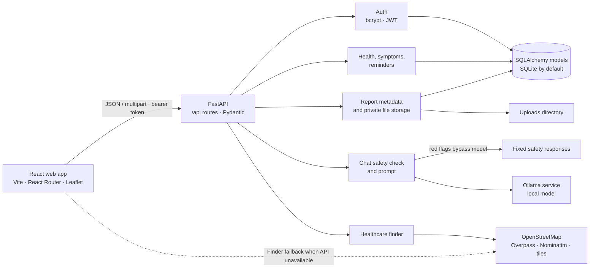

# Sakhi Health

**A more approachable way to learn about, track, and act on women's health.**

Sakhi is a women's healthcare platform built around a practical gap: health information and routine care can be hard to access, understand, and keep track of. It brings together multilingual health information, personal health records, reminders, medical-document storage, and a nearby-care finder in one web app. It is intended for women in India seeking approachable health education and a convenient way to organize their own care—not as a substitute for a clinician.

**Value proposition:** make everyday health information and personal care tools easier to reach, in a language the user can use.

> Sakhi does not diagnose conditions or interpret medical reports. For urgent symptoms, contact emergency services or seek in-person care.

## At a glance

| | |
| --- | --- |
| **Frontend** | React 19, Vite 8, React Router, Leaflet |
| **Backend** | FastAPI, Pydantic, SQLAlchemy, Alembic |
| **Default database** | SQLite |
| **AI chat runtime** | Local Ollama service (default model: `llama3.2:1b`) |
| **Care finder data** | OpenStreetMap, Overpass API, and Nominatim |
| **Languages** | English, Hindi, Kannada, Tamil, Telugu, and Bengali |

## What you can do

These features are present in the application and backend code:

- **Create an account and sign in.** Protected health and report APIs use bearer-token authentication.
- **Keep personal health records.** Record menstrual-cycle dates, flow and notes, along with wellness notes. Data is stored in the configured database.
- **Log symptoms.** Record a symptom, severity, date and optional notes; the API supports listing, editing, and deleting entries.
- **Manage care reminders.** Save medication or preventive-care reminders with a frequency, optional time, and active status.
- **Store medical reports.** Upload, list, download, and remove PDF and image files associated with your account.
- **Ask the health assistant.** A prompt-guided assistant uses a local Ollama model and a small curated health-information knowledge base. It supports six UI/API languages; the prompt asks it to reply in the language of the latest message. Browser speech-to-text and text-to-speech are available where supported by the browser and installed voices.
- **Find nearby care.** Search by current location or place name, and browse hospitals, clinics, pharmacies, and laboratories on a Leaflet map. Filter by facility type and search radius.
- **Use basic safety measures.** Certain detected emergency, self-harm, and abuse messages receive fixed safety responses without calling the model. Personal health and report APIs filter records by the authenticated account.

### Important feature boundaries

- The assistant provides general information; it is **not** an AI diagnostic tool. Safety phrase detection is a limited safeguard, not a clinical triage system.
- Reports are stored and retrieved only; there is **no OCR, report analysis, or automated explanation**.
- Reminders are saved records. The app does **not** send push notifications or SMS.
- Facility listings come from public OpenStreetMap data and may be incomplete or out of date. Confirm details with a facility before travel.
- Browser voice capabilities and available language voices depend on the user's device and browser.

## Screenshots

Screenshots are not currently included in the repository. Replace these placeholders with real captures before using this README in a submission:

- **Home and health tracker:** screenshot placeholder
- **Assistant and safety response:** screenshot placeholder
- **Healthcare finder:** screenshot placeholder

## Architecture



The browser calls the FastAPI backend under `/api`. In development, Vite proxies these requests to `http://localhost:8000`. The assistant sends conversation context with each request but does not persist chat history in the database. Health records and report metadata use SQLAlchemy models; report bytes are written to the configured uploads directory. The finder uses the backend's OpenStreetMap integration and can fall back to public OSM services directly from the browser.

## Technology and repository layout

- **Frontend:** React 19 with Vite 8 and React Router 7. `frontend/src/features/` contains tracker, symptom, reminder, report, chat, and healthcare finder screens; `frontend/src/services/` contains API and language helpers. Leaflet renders the map. Browser speech APIs provide optional voice input/output.
- **Backend:** FastAPI routes are grouped in `backend/app/api/`; Pydantic request/response schemas live in `backend/app/schemas/`. `backend/app/main.py` registers routers and configures CORS.
- **Persistence:** SQLAlchemy models in `backend/app/models/` represent users, health logs, symptom logs, reminders, and report metadata. Alembic configuration and revision files are in `backend/alembic/`.
- **Authentication:** Passlib bcrypt password hashing and signed JWT bearer tokens are implemented in `backend/app/auth.py`.
- **Assistant:** `backend/app/services/` contains Ollama integration, prompt construction, a curated knowledge base, red-flag responses, and an in-memory rate limiter.
- **Healthcare finder:** the backend queries OpenStreetMap's Overpass and Nominatim services; the frontend includes a direct-OSM fallback and Leaflet map.

```text
.
├── backend/
│   ├── app/
│   │   ├── api/           # FastAPI routers
│   │   ├── models/        # SQLAlchemy data models
│   │   ├── schemas/       # Pydantic contracts
│   │   └── services/      # Chat, safety, knowledge base, finder
│   ├── alembic/           # Database migrations
│   ├── tests/             # Backend pytest suite
│   ├── .env.example       # Development environment template
│   └── requirements*.txt
├── frontend/
│   ├── src/
│   │   ├── components/   # Registration and sign-in
│   │   ├── features/     # App feature screens
│   │   ├── hooks/        # Chat and browser speech hooks
│   │   └── services/     # Backend API, languages, finder
│   ├── package.json
│   └── vite.config.js
├── docs/                  # Supporting setup and demo notes
└── render.yaml            # Backend deployment blueprint
```

## Local development (Windows PowerShell)

### Prerequisites

- Git
- Python 3.12 (the deployment blueprint specifies 3.12.3)
- Node.js 20.19+ or 22.12+ and npm (required by the locked Vite toolchain)
- [Ollama](https://ollama.com/) for live assistant responses

SQLite is the default local database; no separate database server is needed. The healthcare finder uses public OpenStreetMap services and requires an internet connection. The API and other app features can run without Ollama, but normal assistant requests will be unavailable and the frontend will use its canned offline replies.

### Clone and set up the backend

Run these commands from the directory where you want the repository:

```powershell
git clone https://github.com/Ishta-P-Jain/Sakhi-Health.git
Set-Location Sakhi-Health\backend

py -3.12 -m venv .venv
.\.venv\Scripts\Activate.ps1
python -m pip install -r requirements-dev.txt
Copy-Item .env.example .env
```

If PowerShell blocks virtual-environment activation, allow scripts for this terminal only, then activate again:

```powershell
Set-ExecutionPolicy -Scope Process -ExecutionPolicy Bypass
.\.venv\Scripts\Activate.ps1
```

Generate a unique development signing key and replace the template value:

```powershell
python -c "from pathlib import Path; import secrets; p=Path('.env'); lines=p.read_text(encoding='utf-8-sig').splitlines(); lines=[('SECRET_KEY='+secrets.token_urlsafe(48)) if line.startswith('SECRET_KEY=') else line for line in lines]; p.write_text('\n'.join(lines)+'\n', encoding='utf-8')"
```

The default SQLite URL and local CORS origin in `backend/.env.example` work for the setup below. The assistant service reads `OLLAMA_BASE_URL` (default `http://localhost:11434`) and `OLLAMA_MODEL` (default `llama3.2:1b`); add or change those entries in `backend/.env` if needed. Start Ollama and download the default model in a separate terminal:

```powershell
ollama serve
```

If the Ollama desktop app is already running, it may already provide the local service; in that case, skip starting another server.

In another terminal, download the model:

```powershell
ollama pull llama3.2:1b
```

> **Configuration note:** the checked-in `.env.example` and Render blueprint still list `ANTHROPIC_API_KEY` and `LLM_MODEL`, but the current chat implementation calls Ollama, not Anthropic. No Anthropic API key is needed for the code as it exists today, and those deployment variables do not make Ollama available. The `/api/ping` response's `llm_configured` value only checks whether `ANTHROPIC_API_KEY` is set; it does **not** verify Ollama connectivity or model readiness. Set a descriptive `GEOCODER_USER_AGENT` with contact information when using Nominatim, as requested by its usage policy.

Apply the initial database migration before starting the app:

```powershell
alembic upgrade head
```

The app also calls SQLAlchemy `create_all()` at startup, which creates missing tables but does not record an Alembic revision. Run the migration first on a fresh database so Alembic tracks the schema before the server initializes. The checked-in Render blueprint starts Uvicorn directly and does not run Alembic; run `alembic upgrade head` as a separate deployment step if using that blueprint.

Start the API:

```powershell
python -m uvicorn app.main:app --reload --port 8000
```

Open [Swagger UI](http://localhost:8000/docs) for interactive API documentation. The health-check route is [http://localhost:8000/api/ping](http://localhost:8000/api/ping).

### Set up and start the frontend

Open a second PowerShell terminal at the repository root:

```powershell
Set-Location frontend
npm ci
npm run dev
```

Open the Vite URL printed in the terminal (normally `http://localhost:5173`). The Vite development server proxies `/api` to `http://localhost:8000`, so leave `VITE_API_URL` unset for the standard local setup. The backend's default `CORS_ORIGINS` already allows `http://localhost:5173`.

For a direct API connection instead of the Vite proxy, set `VITE_API_URL=http://localhost:8000` in `frontend/.env.local` and make sure `CORS_ORIGINS` in `backend/.env` includes the exact frontend origin, for example `http://localhost:5173`. For a hosted frontend, set `VITE_API_URL` to the backend origin and `CORS_ORIGINS` to the hosted frontend origin. Restart the relevant server after changing environment variables.

To configure a direct local connection from the repository root in PowerShell:

```powershell
Set-Content -Path .\frontend\.env.local -Value 'VITE_API_URL=http://localhost:8000'
$backendEnv = Get-Content .\backend\.env
$backendEnv = $backendEnv -replace '^CORS_ORIGINS=.*$', 'CORS_ORIGINS=http://localhost:5173'
Set-Content -Path .\backend\.env -Value $backendEnv -Encoding UTF8
```

### Environment variables

| Variable | Runtime behavior |
| --- | --- |
| `DATABASE_URL` | Database connection; defaults to `sqlite:///./sakhi.db` (relative to the backend working directory). |
| `SECRET_KEY` | JWT signing key. The code default is an insecure development placeholder; replace it, and use a strong secret in any deployed environment. |
| `JWT_ALGORITHM` | JWT algorithm; defaults to `HS256`. |
| `ACCESS_TOKEN_EXPIRE_MINUTES` | Token lifetime; defaults to 10,080 minutes (7 days). |
| `CORS_ORIGINS` | Comma-separated allowed frontend origins; defaults to `http://localhost:5173`. |
| `UPLOAD_DIR` | Report upload directory; defaults to `uploads` relative to the backend working directory. |
| `MAX_UPLOAD_MB` | Maximum report upload size; defaults to 5 MB. |
| `OLLAMA_BASE_URL` | Ollama service URL read by the chat integration; defaults to `http://localhost:11434`. |
| `OLLAMA_MODEL` | Ollama model name; defaults to `llama3.2:1b`. |
| `GEOCODER_USER_AGENT` | User-Agent sent to public OSM services; use a descriptive value with contact information. |
| `GEOCODE_COUNTRY` | Nominatim country-code filter; defaults to `in`. |
| `CHAT_RATE_LIMIT_PER_MINUTE` | In-memory chat limit per client IP; defaults to 20. |

Do not commit `.env`, tokens, generated keys, or other secrets. `.env` is ignored by Git; keep production secrets in your deployment platform's secret settings. The Anthropic and generic `LLM_*` entries in the example file do not configure the current Ollama chat implementation.

## API reference

All routes below are served by the FastAPI app. `/docs` provides the authoritative interactive schemas and endpoint details while the server is running. Protected routes require `Authorization: Bearer <access_token>`.

### Health check, authentication, and assistant

| Method | Path | Authentication | Purpose |
| --- | --- | --- | --- |
| `GET` | `/api/ping` | No | Returns service status and the `llm_configured` flag (which currently reflects the Anthropic-key setting, not Ollama readiness). |
| `POST` | `/api/auth/register` | No | Create an account. Body: `email`, `password` (6–128 chars), optional `full_name`. Returns a user record (`201`), not a token. |
| `POST` | `/api/auth/login` | No | Sign in with `email` and `password`; returns `access_token` and `token_type`. |
| `GET` | `/api/auth/me` | Bearer token | Return the current account. |
| `POST` | `/api/chat` | No | Send `message` (1–1,000 characters), optional `language` (`en`, `hi`, `kn`, `ta`, `te`, `bn`, default `en`), and up to 20 `history` turns (the model uses at most the latest 10). Returns `reply`, `language`, `source` (`llm` or `safety`), and optional `safety_category`. Rate limited; may return `429` or `503`. |

### Healthcare finder

| Method | Path | Authentication | Purpose |
| --- | --- | --- | --- |
| `GET` | `/api/healthcare/nearby` | No | Find facilities by required `lat` and `lng`; optional `radius_km` (1–25, default 5) and comma-separated `types` (`hospital`, `clinic`, `pharmacy`, `lab`). |
| `GET` | `/api/healthcare/geocode` | No | Resolve a place query using required `q` (2–120 characters); returns `404` when no result is found. |

### Health logs and symptoms

| Method | Path | Authentication | Purpose |
| --- | --- | --- | --- |
| `POST` | `/api/health/logs` | Bearer token | Create a health log. Optional fields: `cycle_start_date`, `cycle_end_date`, `flow_level` (`light`, `medium`, `heavy`), and `notes`. |
| `GET` | `/api/health/logs` | Bearer token | List the current user's health logs. Optional filters: `start`, `end`, `limit`, `offset`. |
| `GET` | `/api/health/logs/{log_id}` | Bearer token | Retrieve one of the current user's health logs. |
| `PUT` | `/api/health/logs/{log_id}` | Bearer token | Update supplied health-log fields. |
| `DELETE` | `/api/health/logs/{log_id}` | Bearer token | Delete a health log; returns `204`. |
| `POST` | `/api/symptoms` | Bearer token | Create a symptom record. Required: `symptom`, `severity` (`mild`, `moderate`, `severe`), `occurred_at`; optional `notes`. |
| `GET` | `/api/symptoms` | Bearer token | List the current user's symptom records; accepts `limit` and `offset`. |
| `GET` | `/api/symptoms/{log_id}` | Bearer token | Retrieve one of the current user's symptom records. |
| `PUT` | `/api/symptoms/{log_id}` | Bearer token | Update supplied symptom-record fields. |
| `DELETE` | `/api/symptoms/{log_id}` | Bearer token | Delete a symptom record; returns `204`. |

### Reminders and reports

| Method | Path | Authentication | Purpose |
| --- | --- | --- | --- |
| `POST` | `/api/reminders` | Bearer token | Create a reminder. Required: `title`, `kind` (`medication` or `preventive_care`), `frequency` (`daily`, `weekly`, `monthly`, `custom`); optional `time_of_day`, `active`. |
| `GET` | `/api/reminders` | Bearer token | List reminders; optional `active`, `kind`, `limit`, and `offset` filters. |
| `GET` | `/api/reminders/{reminder_id}` | Bearer token | Retrieve one of the current user's reminders. |
| `PUT` | `/api/reminders/{reminder_id}` | Bearer token | Update reminder fields, including `active` or `last_taken`. |
| `DELETE` | `/api/reminders/{reminder_id}` | Bearer token | Delete a reminder; returns `204`. |
| `POST` | `/api/reports/upload` | Bearer token | Upload a multipart form field named `file`; returns report metadata (`201`). |
| `GET` | `/api/reports` | Bearer token | List the current user's report metadata; accepts `limit` and `offset`. |
| `GET` | `/api/reports/{report_id}` | Bearer token | Retrieve one report's metadata. |
| `GET` | `/api/reports/{report_id}/file` | Bearer token | Download the report file. |
| `DELETE` | `/api/reports/{report_id}` | Bearer token | Delete a report and its stored file when present; returns `204`. |

Invalid request bodies and query parameters generally return `422`. Protected routes return `401` without a valid token; attempts to access another account's records return `404`.

## Data, privacy, and security

- **Account separation:** health logs, symptoms, reminders, and report metadata are associated with a user ID. Protected list and item operations filter by the authenticated account; tests cover cross-account access for these resources.
- **Passwords and sessions:** passwords are hashed using bcrypt via Passlib. Login issues a signed JWT; protected requests send it as a bearer token. The default signing key is explicitly for development and must be replaced before deployment. The frontend stores the token in browser `localStorage`.
- **Database changes:** use `alembic upgrade head` to apply the checked-in migration. SQLite is the supported zero-setup local default. The app additionally calls SQLAlchemy `create_all()` at startup for development.
- **Chat data:** there is no chat-history table or persistence endpoint. The browser sends recent conversation context with each chat request. The assistant endpoint is not authenticated and uses an in-memory, single-process per-IP rate limiter.
- **Report uploads:** accepted filename extensions are `.pdf`, `.png`, `.jpg`, and `.jpeg`; empty files and files over `MAX_UPLOAD_MB` (5 MB by default) are rejected. Files are stored under `UPLOAD_DIR`, outside the frontend's public static assets, with generated storage names. Validation is based on the filename extension and size; the code does not scan file contents for malware or verify file signatures.
- **Transport and deployment:** use HTTPS for hosted deployments, configure exact CORS origins, protect environment secrets, and provide persistent storage for the database and uploaded files. The repository does not claim a formal security audit.

## Testing and quality checks

Backend tests use pytest with an in-memory SQLite database and cover authentication, database models, health logs, symptoms, reminders, report uploads, chat behavior, safety responses, and healthcare finder parsing/routes. The current suite collects **69 tests across 9 test modules**.

```powershell
# From the backend directory, with its virtual environment activated
python -m pytest
```

The frontend includes four Node.js regression tests for registration sign-in, `204 No Content` responses, multipart uploads, and authenticated report downloads. The tests use Node's built-in test runner; no additional test dependency is required.

```powershell
# From the frontend directory
npm test
npm run build
npm run lint
```

## Hackathon overview

### Problem

Women may have difficulty finding approachable, language-accessible health information and keeping track of recurring health details, symptoms, care routines, and medical documents.

### Proposed solution

Sakhi combines personal health logging and report storage with multilingual educational chat and an OpenStreetMap-based care finder. It is designed as a practical companion for organizing information and locating possible care options; it does not replace clinical evaluation.

### Example user journey

1. Create an account and sign in.
2. Record a cycle date, wellness note, or symptom and set a medication or preventive-care reminder.
3. Ask the assistant a general health question in one of the supported languages, or use optional browser voice input/output.
4. Search near the current location or a place name to view mapped health facilities and available contact/directions links.
5. Upload a report to keep it with the account for later retrieval.

**Signup note:** the registration API returns a user record rather than a token. The frontend now follows successful registration with a login request to establish the session.

### Intended beneficiaries and potential impact

The app is intended for women who want accessible health education and simple personal record-keeping, including users who prefer one of the supported Indian languages. By bringing these tools together, Sakhi aims to make it easier to prepare for conversations with healthcare professionals and explore nearby care. No clinical or social impact has been measured or validated.

### Current limitations

- The assistant depends on a reachable Ollama service and installed model for generated answers. Without it, the backend can return `503`; the frontend has canned offline replies. Fixed safety responses are limited pattern-based safeguards, not a substitute for emergency services.
- Report interpretation and OCR are not implemented, and reminders do not generate push or SMS notifications.
- OpenStreetMap facility data may be incomplete. Location access and browser speech APIs require user permission and device/browser support.
- The Render and Vercel configuration files are deployment scaffolding, not a published, validated demo. The Render blueprint does not run Alembic migrations and does not provide an Ollama service. A hosted backend needs a reachable Ollama service and persistent storage for SQLite and uploads.

### Potential next steps (not implemented)

- Add clinician-reviewed, versioned health content and evaluate the assistant's safety behavior with domain experts.
- Consider OCR or plain-language report explanations only with an explicit privacy, validation, and clinical-safety design.
- Add notification delivery, verified provider listings, and appointment workflows if supported by user research and suitable partners.
- Complete deployment hardening, persistent storage configuration, and an independent security review before production use.

## Demo, deployment, and credits

No live demo URL, deployed environment, hackathon submission link, screenshots, or verified team names and roles are present in the repository. Render and Vercel configuration files are included, but they are not evidence of a working public deployment. Add those links and credits here when they are available and verified.
